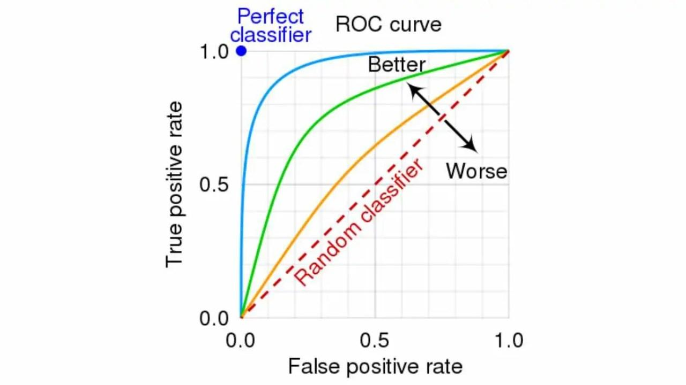
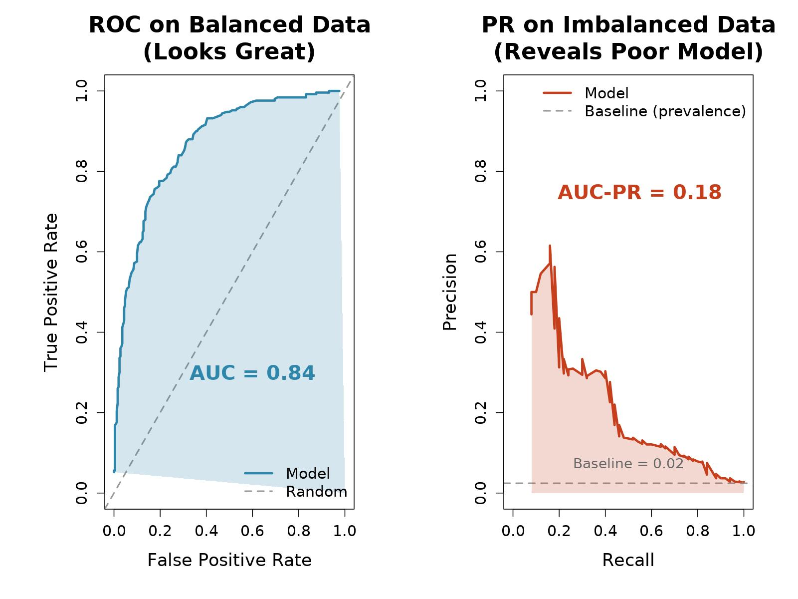

# Egri chiziqqa asoslangan metrikalar

**Egri chiziqqa asoslangan metrikalar (*curve-based metrics*)** — klassifikatsiya modelining sifatini bitta threshold (chegara) qiymatida emas, balki barcha threshold qiymatlari bo'yicha baholaydigan ko'rsatkichlar. Sahifada uchta metrika tushuntiriladi: **ROC-AUC**, **PR-AUC** va **Average Precision (AP)**.

Har bir metrika alohida savolga javob beradi:

- "Model ijobiy va salbiy obyektlarni qanchalik yaxshi ajratadi?" → ROC-AUC
- "Model topgan ijobiy obyektlar qanchalik ishonchli va haqiqiy ijobiy obyektlarning qanchasi topildi?" → PR-AUC, AP

*! Sinflar **nomutanosib** (*imbalanced*) bo'lgan datasetlarda PR-AUC va AP alohida ahamiyatga ega, chunki ROC-AUC kam uchraydigan sinfdagi muammoni yashirishi mumkin.*

Tushuntirish tartibi:

1. Misol dataset.
2. Confusion matrix.
3. TP, FP, FN, TN qiymatlari.
4. Threshold tushunchasi.
5. ROC egri chizig'i va ROC-AUC.
6. Precision-Recall egri chizig'i va PR-AUC.
7. Average Precision (AP).
8. Uchala metrikani taqqoslash.

---

<h2>Misol dataset</h2>

Model 100 nafar bemorni 3 sinfga ajratadi:

| Sinf | Bemorlar soni | Ulushi |
|---|---|---|
| Sog'lom | 80 | 80% |
| Gripp | 15 | 15% |
| Kovid | 5 | 5% |
| **Jami** | **100** | **100%** |

Dataset nomutanosib: sog'lom bemorlar 80% ni, Kovid bemorlari esa atigi 5% ni tashkil qiladi.

*! Jadvalda faqat haqiqiy sinflar soni berilgan. Confusion matrix tuzish uchun model bashoratlari ham kerak. Quyidagi hisob-kitoblarda tushuntirish maqsadida namunaviy bashorat natijalari ishlatiladi.*

---

<h2>Confusion matrix (chalkashlik matritsasi)</h2>

Model quyidagi natijalarni bergan bo'lsin:

| Haqiqiy ↓ / Bashorat → | Sog'lom | Gripp | Kovid | **Jami (haqiqiy)** |
|---|---|---|---|---|
| **Sog'lom** | **72** | 6 | 2 | 80 |
| **Gripp** | 3 | **10** | 2 | 15 |
| **Kovid** | 1 | 1 | **3** | 5 |
| **Jami (bashorat)** | 76 | 17 | 7 | **100** |

Jadvalni o'qish tartibi:

- 72 nafar sog'lom bemor to'g'ri aniqlangan.
- 10 nafar gripp bemori to'g'ri aniqlangan.
- 3 nafar Kovid bemori to'g'ri aniqlangan.
- **Diagonal** (qalin sonlar) — to'g'ri bashoratlar.

Accuracy:

$$
\text{Accuracy} = \frac{72+10+3}{100} = \mathbf{0.85}
$$

Sodda ma'nosi: 100 ta bemordan 85 tasi to'g'ri tasniflangan.

*! Yuqori accuracy model barcha sinflarni yaxshi aniqlayotganini bildirmaydi. Masalan, Kovid sinfida atigi 3 ta bemor to'g'ri aniqlangan.*

---

<h2>TP, FP, FN, TN</h2>

ROC-AUC, PR-AUC va AP hisoblashda har bir sinf alohida qaraladi. Usul nomi — **One-vs-Rest (OvR)**.

Masalan, Kovid sinfini baholashda:

- Kovid — **Positive** (ijobiy sinf).
- Sog'lom va Gripp — **Negative** (salbiy sinflar).

Sog'lom sinfi:

| Ko'rsatkich | Qiymat | Izoh |
|---|---|---|
| TP | 72 | Sog'lom bemor to'g'ri "sog'lom" deb topilgan |
| FP | 3 + 1 = 4 | Boshqa sinfdagi bemor "sog'lom" deb topilgan |
| FN | 6 + 2 = 8 | Sog'lom bemor boshqa sinfga kiritilgan |
| TN | 100 − 72 − 4 − 8 = 16 | Sog'lom bo'lmagan bemor "sog'lom" deb topilmagan |

Gripp sinfi:

| Ko'rsatkich | Qiymat | Izoh |
|---|---|---|
| TP | 10 | Gripp bemori to'g'ri "gripp" deb topilgan |
| FP | 6 + 1 = 7 | Boshqa sinfdagi bemor "gripp" deb topilgan |
| FN | 3 + 2 = 5 | Gripp bemori boshqa sinfga kiritilgan |
| TN | 100 − 10 − 7 − 5 = 78 | Gripp bo'lmagan bemor "gripp" deb topilmagan |

Kovid sinfi:

| Ko'rsatkich | Qiymat | Izoh |
|---|---|---|
| TP | 3 | Kovid bemori to'g'ri "Kovid" deb topilgan |
| FP | 2 + 2 = 4 | Boshqa sinfdagi bemor "Kovid" deb topilgan |
| FN | 1 + 1 = 2 | Kovid bemori boshqa sinfga kiritilgan |
| TN | 100 − 3 − 4 − 2 = 91 | Kovid bo'lmagan bemor "Kovid" deb topilmagan |

Demak, uchta sinf uchun uchta alohida binary classification (ikki sinfli) masala hosil bo'ldi.

---

<h2>Threshold (chegara qiymati)</h2>

Model har bir bemor uchun tayyor sinf nomini emas, balki sinfga tegishlilik ehtimolini yoki **score** qiymatini chiqaradi. **Threshold** — score qaysi qiymatdan boshlab "ijobiy" deb hisoblanishini belgilaydigan chegara.

Kovid sinfi uchun bir nechta bemor misoli:

| Bemor | Kovid uchun score | Haqiqiy holat |
|---|---|---|
| 1 | 0.95 | Kovid |
| 2 | 0.85 | Sog'lom |
| 3 | 0.80 | Kovid |
| 4 | 0.70 | Gripp |
| 5 | 0.60 | Kovid |
| 6 | 0.45 | Kovid |
| 7 | 0.30 | Sog'lom |

- Threshold = 0.5 bo'lsa, score 0.5 yoki yuqoriroq bo'lgan bemorlar (1–5) "Kovid" deb belgilanadi. 6-bemor Kovid bo'lsa ham o'tkazib yuboriladi.
- Threshold = 0.3 bo'lsa, barcha 7 bemor "Kovid" deb belgilanadi. 6-bemor topiladi, lekin 7-bemor bekorga "Kovid" deb belgilanadi.

Natijada:

- Threshold pasaysa, odatda TP ortadi, lekin FP ham ortadi.
- Threshold oshsa, odatda FP kamayadi, lekin FN ortadi.

*! Confusion matrix modelning faqat bitta threshold qiymatidagi natijasini ko'rsatadi. ROC va PR egri chiziqlari esa threshold o'zgarganda natija qanday o'zgarishini ko'rsatadi.*

---

## ROC-AUC

**ROC (*Receiver Operating Characteristic*) egri chizig'i** — turli threshold qiymatlarida model ijobiy obyektlarni qanchalik to'liq topishini va salbiy obyektlarni qanchalik ko'p noto'g'ri "ijobiy" deb belgilashini ko'rsatadigan grafik.

Savol: model ijobiy va salbiy obyektlarni qanchalik yaxshi ajratadi?

ROC egri chizig'ini qurish uchun ikkita ko'rsatkich kerak.

**TPR (*True Positive Rate*)** — haqiqiy ijobiy obyektlarning qancha qismi to'g'ri aniqlangan. Recall bilan bir xil.

$$
TPR = \frac{TP}{TP + FN}
$$

**FPR (*False Positive Rate*)** — salbiy obyektlarning qancha qismi noto'g'ri ravishda "ijobiy" deb aniqlangan.

$$
FPR = \frac{FP}{FP + TN}
$$

ROC grafigida:

- X o'qi — FPR.
- Y o'qi — TPR.

Grafikni o'qish tartibi:

- **Yuqori chap burchak** (FPR = 0, TPR = 1) — mukammal klassifikator.
- **Qizil punktir diagonal** — tasodifiy klassifikator.
- Egri chiziq yuqori chap burchakka yaqinlashgan sari modelning ajratish qobiliyati yaxshilanadi.

<h3>Confusion matrix asosida ROC nuqtalari</h3>

Confusion matrix shartli ravishda threshold = 0.5 holatiga mos deb olinadi.

Sog'lom:

$$
TPR = \frac{72}{72+8} = 0.9 \qquad FPR = \frac{4}{4+16} = 0.2
$$

Gripp:

$$
TPR = \frac{10}{10+5} = 0.6667 \qquad FPR = \frac{7}{7+78} = 0.0824
$$

Kovid:

$$
TPR = \frac{3}{3+2} = 0.6 \qquad FPR = \frac{4}{4+91} = 0.0421
$$

| Sinf | FPR (X) | TPR (Y) | ROC nuqtasi (FPR, TPR) |
|---|---|---|---|
| Sog'lom | 0.2000 | 0.9000 | (0.2, 0.9) |
| Gripp | 0.0824 | 0.6667 | (0.0824, 0.6667) |
| Kovid | 0.0421 | 0.6000 | (0.0421, 0.6) |

*! Yuqoridagi hisob-kitob har bir sinf uchun ROC grafigidagi faqat bitta nuqtani beradi. ROC-AUC hisoblash uchun bir nechta threshold qiymatidagi nuqtalar kerak.*

<h3>ROC-AUC formulasi va talqini</h3>

**AUC (*Area Under the Curve*)** — egri chiziq ostidagi yuza. ROC-AUC — ROC egri chizig'i ostidagi yuza:

$$
ROC\text{-}AUC = \int_0^1 TPR(FPR)\,dFPR
$$

Sodda ma'nosi: ROC-AUC modelning ijobiy va salbiy obyektlarni ajrata olish qobiliyatini bitta son bilan baholaydi.

| ROC-AUC | Baho |
|---|---|
| 1.00 | Mukammal ajratish |
| 0.90 – 1.00 | Juda yaxshi |
| 0.80 – 0.90 | Yaxshi |
| 0.70 – 0.80 | Qoniqarli |
| 0.60 – 0.70 | Zaif |
| 0.50 | Tasodifiy ajratish |
| 0.50 dan past | Tasodifiy ajratishdan yomon |

*! ROC-AUC sinflar nomutanosibligiga PR-AUC'ga qaraganda kamroq sezgir. Kam uchraydigan sinfdagi xatolarni baholashda faqat ROC-AUC yetarli bo'lmasligi mumkin.*

---

## PR-AUC

**Precision-Recall (PR) egri chizig'i** — turli threshold qiymatlarida model "ijobiy" deb topgan obyektlarning qanchasi haqiqatan ijobiy ekanini va haqiqiy ijobiy obyektlarning qanchasi topilganini ko'rsatadigan grafik.

Savol: model topgan ijobiy obyektlar qanchalik ishonchli va haqiqiy ijobiy obyektlarning qanchasi topildi?

PR egri chizig'ini qurish uchun ikkita ko'rsatkich kerak.

**Precision** — model "ijobiy" deb topgan obyektlarning qancha qismi haqiqatan ijobiy.

$$
\text{Precision} = \frac{TP}{TP + FP}
$$

**Recall** — haqiqiy ijobiy obyektlarning qancha qismi model tomonidan aniqlangan.

$$
\text{Recall} = \frac{TP}{TP + FN}
$$

PR grafigida:

- X o'qi — Recall.
- Y o'qi — Precision.

Rasmda ikki xil baholash yonma-yon ko'rsatilgan:

- **Chapda** — muvozanatli datasetdagi ROC egri chizig'i. AUC = 0.84, model yaxshi ko'rinadi.
- **O'ngda** — nomutanosib datasetdagi PR egri chizig'i. AUC-PR = 0.18, model zaif ekani ochiq ko'rinadi.
- **Kulrang punktir chiziq** — tasodifiy model darajasi (baseline). ROC grafigida baseline diagonal, PR grafigida esa ijobiy sinf ulushiga teng gorizontal chiziq (rasmda 0.02).

<h3>Confusion matrix asosida PR nuqtalari</h3>

Threshold = 0.5 holatida:

Sog'lom:

$$
\text{Precision} = \frac{72}{72+4} = 0.9474 \qquad \text{Recall} = \frac{72}{72+8} = 0.9
$$

Gripp:

$$
\text{Precision} = \frac{10}{10+7} = 0.5882 \qquad \text{Recall} = \frac{10}{10+5} = 0.6667
$$

Kovid:

$$
\text{Precision} = \frac{3}{3+4} = 0.4286 \qquad \text{Recall} = \frac{3}{3+2} = 0.6
$$

| Sinf | Recall (X) | Precision (Y) | PR nuqtasi (Recall, Precision) |
|---|---|---|---|
| Sog'lom | 0.9000 | 0.9474 | (0.9, 0.9474) |
| Gripp | 0.6667 | 0.5882 | (0.6667, 0.5882) |
| Kovid | 0.6000 | 0.4286 | (0.6, 0.4286) |

Sodda ma'nosi (Kovid): model "Kovid" deb belgilagan 7 nafar bemordan faqat 3 nafari haqiqatan Kovid bemori. Demak, Kovid sinfida yolg'on xavotir (FP) ko'p. Aynan PR egri chizig'i kamchilikni yaqqol ko'rsatadi.

<h3>PR-AUC formulasi va talqini</h3>

PR-AUC — Precision-Recall egri chizig'i ostidagi yuza:

$$
PR\text{-}AUC = \int_0^1 \text{Precision}(\text{Recall})\,d\,\text{Recall}
$$

Sodda ma'nosi: PR-AUC ijobiy obyektlarni topish qobiliyatini (recall) va topilgan obyektlarning ishonchliligini (precision) birgalikda baholaydi. Yuqori PR-AUC yaxshi modelni bildiradi.

<h3>Nega PR-AUC nomutanosib datasetda muhim?</h3>

Misol datasetda Kovid bemorlari atigi 5 nafar:

- Model 5 nafar Kovid bemoridan 3 nafarini topdi.
- Qo'shimcha ravishda 4 nafar sog'lom yoki gripp bemori ham "Kovid" deb belgilandi.

Recall = 0.6 bo'lsa ham, Precision = 0.4286.

FP = 4 qiymati ikki metrikada turlicha ko'rinadi:

- **ROC egri chizig'ida** FP barcha 95 ta salbiy obyektga nisbatan olinadi: FPR = 4 / 95 = 0.0421. Xato juda kichik ko'rinadi.
- **PR egri chizig'ida** FP to'g'ridan-to'g'ri precision qiymatini pasaytiradi: 3 / 7 = 0.4286. Xato yaqqol ko'rinadi.

*! Salbiy obyektlar juda ko'p bo'lganda FPR deyarli o'zgarmaydi, precision esa keskin tushadi. PR-AUC kam uchraydigan sinflarni baholashda juda foydali bo'lishining sababi aynan precision sezgirligida.*

---

## Average Precision (AP)

**Average Precision (AP)** — turli threshold qiymatlarida olingan precision va recall natijalarini birlashtiradigan va ijobiy sinfni aniqlash sifatini bitta son bilan baholaydigan metrika. AP — PR egri chizig'i ostidagi yuzani hisoblashning maxsus usuli.

$$
AP = \sum_{k=1}^{n}(R_k - R_{k-1})\,P_k
$$

Belgilar:

- $R_k$ — $k$-qadamdagi recall.
- $R_{k-1}$ — oldingi qadamdagi recall ($R_0 = 0$).
- $P_k$ — $k$-qadamdagi precision.
- $n$ — threshold o'zgarishi natijasida hosil bo'lgan qadamlar soni.

Sodda ma'nosi: har bir qadamda recall qanchaga oshgani olinadi va oshish miqdori joriy qadamdagi precision qiymatiga ko'paytiriladi. Precision yuqori bo'lsa, AP ham yuqori bo'ladi. Yolg'on xavotir (FP) ko'paysa, precision pasayadi va AP ham pasayadi.

<h3>Kovid sinfi uchun AP hisobi</h3>

Haqiqiy Kovid bemorlari soni: 5 ta. Hisoblash uchun turli threshold qiymatlaridagi namunaviy natijalar olinadi.

*! Jadvaldagi sonlar o'quv maqsadida tuzilgan. Threshold = 0.5 qatoridagi TP va FP qiymatlari yuqoridagi confusion matrix bilan mos keladi.*

| Threshold | TP | FP | Recall = TP / 5 | Precision = TP / (TP + FP) |
|---|---|---|---|---|
| 0.9 | 1 | 0 | 0.2 | 1.0000 |
| 0.7 | 2 | 1 | 0.4 | 0.6667 |
| 0.5 | 3 | 4 | 0.6 | 0.4286 |
| 0.3 | 4 | 15 | 0.8 | 0.2105 |
| 0.1 | 5 | 95 | 1.0 | 0.0500 |

Qiymatlar AP formulasiga qo'yiladi:

$$
\begin{aligned}
AP = {} & (0.2 - 0) \cdot 1 \\
& + (0.4 - 0.2) \cdot 0.6667 \\
& + (0.6 - 0.4) \cdot 0.4286 \\
& + (0.8 - 0.6) \cdot 0.2105 \\
& + (1 - 0.8) \cdot 0.05
\end{aligned}
$$

$$
AP = 0.2 + 0.13334 + 0.08572 + 0.04210 + 0.01 = \mathbf{0.4712}
$$

Demak, Kovid sinfi uchun Average Precision taxminan **0.4712** (47.12%).

<h3>PR-AUC va AP farqi</h3>

PR-AUC va AP ko'pincha bir xil metrika deb qaraladi, lekin hisoblash usulida farq bor:

- **PR-AUC** — PR egri chizig'i ostidagi yuza odatda **trapetsiyalar usulida** hisoblanadi: qo'shni nuqtalar to'g'ri chiziq bilan tutashtiriladi.
- **AP** — recall o'sishining har bir oralig'i joriy qadamdagi precision qiymatiga ko'paytiriladi va natijalar qo'shiladi (**zinapoyasimon** hisob).

Kovid sinfi misolida:

| Metrika | Qiymat | Foizda |
|---|---|---|
| PR-AUC (trapetsiyalar usuli) | 0.5662 | 56.62% |
| Average Precision | 0.4712 | 47.12% |

Demak, PR-AUC va AP bir xil son bo'lishi shart emas.

*! Ayrim dasturiy kutubxonalar PR-AUC atamasini AP ma'nosida ham ishlatadi. Ilmiy maqolada qaysi integrallash usuli qo'llangani aniq ko'rsatilishi kerak. Masalan, scikit-learn kutubxonasidagi `average_precision_score` trapetsiyalar usulidan emas, yuqoridagi AP yig'indisidan foydalanadi.*

---

<h2>Threshold jadvali</h2>

Uchala metrikani barcha sinflar uchun hisoblashda bir nechta threshold qiymatidagi natijalar kerak bo'ladi.

*! Jadvaldagi TP va FP qiymatlari o'quv maqsadida tanlangan. Threshold = 0.5 qatoridagi qiymatlar confusion matrix bilan mos, qolgan qiymatlar egri chiziqlarni hosil qilish uchun qo'shimcha farazlar.*

| Sinf | Threshold | TP | FP |
|---|---|---|---|
| Sog'lom | 0.9 | 30 | 0 |
| Sog'lom | 0.7 | 60 | 1 |
| Sog'lom | 0.5 | 72 | 4 |
| Sog'lom | 0.3 | 78 | 10 |
| Sog'lom | 0.1 | 80 | 20 |
| Gripp | 0.9 | 3 | 0 |
| Gripp | 0.7 | 7 | 2 |
| Gripp | 0.5 | 10 | 7 |
| Gripp | 0.3 | 13 | 20 |
| Gripp | 0.1 | 15 | 85 |
| Kovid | 0.9 | 1 | 0 |
| Kovid | 0.7 | 2 | 1 |
| Kovid | 0.5 | 3 | 4 |
| Kovid | 0.3 | 4 | 15 |
| Kovid | 0.1 | 5 | 95 |

Har bir threshold uchun quyidagi qiymatlar hisoblanadi:

$$
TPR = \frac{TP}{P} \qquad FPR = \frac{FP}{N}
$$

$$
\text{Precision} = \frac{TP}{TP + FP} \qquad \text{Recall} = \frac{TP}{P}
$$

Belgilar: $P$ — ijobiy sinfdagi obyektlar soni, $N$ — salbiy sinfdagi obyektlar soni. Masalan, Kovid uchun $P = 5$, $N = 95$.

Hosil bo'lgan nuqtalar asosida:

- ROC grafigi quriladi, grafik ostidagi yuza — ROC-AUC.
- PR grafigi quriladi, grafik ostidagi yuza — PR-AUC.
- Recall o'zgarishlari va mos precision qiymatlari asosida AP hisoblanadi.

---

<h2>Yakuniy natijalar</h2>

ROC-AUC va PR-AUC trapetsiyalar usulida, Average Precision esa AP formulasi yordamida hisoblangan:

| Sinf | ROC-AUC | PR-AUC | AP |
|---|---|---|---|
| Sog'lom | 0.9269 | 0.9816 | 0.9724 |
| Gripp | 0.8722 | 0.7081 | 0.6238 |
| Kovid | 0.8579 | 0.5662 | 0.4712 |

*! Barcha qiymatlar sun'iy threshold ma'lumotlari asosidagi namunaviy hisob-kitob natijasi, haqiqiy model natijasi emas.*

Natijalar tahlili:

- **Sog'lom** — uchala metrika ham yuqori (0.93 – 0.98). Model sog'lom bemorlarni yaxshi aniqlaydi.
- **Gripp** — ROC-AUC = 0.8722, PR-AUC = 0.7081, AP = 0.6238. Gripp sinfi sog'lom sinfiga qaraganda sustroq ajratiladi.
- **Kovid** — ROC-AUC = 0.8579 nisbatan yuqori, lekin PR-AUC = 0.5662 va AP = 0.4712 ancha past.

*! Kovid sinfida ROC-AUC "yaxshi" degan baho beradi, PR-AUC va AP esa kam uchraydigan sinfda yolg'on xavotir (FP) muammosi borligini ko'rsatadi.*

---

<h2>Umumiy son: Macro va Weighted o'rtacha</h2>

ROC-AUC, PR-AUC va AP har bir sinf uchun alohida hisoblanadi. Butun model uchun bitta umumiy son olishning ikki asosiy usuli bor.

**Macro (oddiy o'rtacha)** — har bir sinf natijasi teng ahamiyatga ega.

$$
ROC_{\text{macro}} = \frac{ROC_1 + ROC_2 + ROC_3}{3} = \frac{0.9269 + 0.8722 + 0.8579}{3} = \mathbf{0.8856}
$$

$$
PR_{\text{macro}} = \frac{0.9816 + 0.7081 + 0.5662}{3} = \mathbf{0.7520}
$$

$$
AP_{\text{macro}} = \frac{0.9724 + 0.6238 + 0.4712}{3} = \mathbf{0.6891}
$$

**Weighted (tortilgan o'rtacha)** — har bir sinf natijasi sinfning datasetdagi ulushiga qarab hisobga olinadi.

$$
AP_{\text{weighted}} = 0.80 \cdot AP_{\text{sog'lom}} + 0.15 \cdot AP_{\text{gripp}} + 0.05 \cdot AP_{\text{kovid}}
$$

$$
AP_{\text{weighted}} = 0.80 \cdot 0.9724 + 0.15 \cdot 0.6238 + 0.05 \cdot 0.4712 = \mathbf{0.8951}
$$

Sog'lom sinfi 80% ulushga ega va umumiy natijaga eng katta ta'sir ko'rsatadi: weighted AP (0.8951) macro AP'dan (0.6891) ancha yuqori chiqdi.

*! Nomutanosib datasetda macro o'rtacha ko'pincha foydaliroq, chunki kam uchraydigan Kovid sinfi ham sog'lom sinfi bilan teng vaznga ega bo'ladi.*

---

<h2>Uchala metrika farqi</h2>

| Xususiyat | ROC-AUC | PR-AUC | AP |
|---|---|---|---|
| Asosiy ko'rsatkichlar | TPR va FPR | Precision va Recall | Precision va Recall |
| Grafik | ROC egri chizig'i | PR egri chizig'i | PR egri chizig'i asosidagi yig'indi |
| Yolg'on xavotir (FP) hisobi | FPR orqali | Precision orqali | Precision orqali |
| Sinflar nomutanosibligida | Kamroq sezgir | Juda foydali | Juda foydali |
| Hisoblash | Egri chiziq ostidagi yuza | Egri chiziq ostidagi yuza | Recall qadamlaridagi precision yig'indisi |
| Tasodifiy model darajasi | 0.5 | Ijobiy sinf ulushi | Ijobiy sinf ulushi |

Metrika tanlash:

- **ROC-AUC** — modelning umumiy ajratish qobiliyatini baholash kerak bo'lganda. Ijobiy va salbiy obyektlar qanchalik yaxshi farqlanishini ko'rsatadi.
- **PR-AUC** — kam uchraydigan sinfni aniqlash muhim bo'lganda, ayniqsa FP ko'payishi model sifatiga jiddiy ta'sir qiladigan vaziyatlarda.
- **Average Precision (AP)** — har bir sinf uchun precision va recall muvozanatini bitta son bilan baholash kerak bo'lganda. Object detection va nomutanosib klassifikatsiya masalalarida keng qo'llanadi.

---

<h2>Confusion matrix yetarlimi?</h2>

Faqat confusion matrix asosida ROC-AUC, PR-AUC va AP'ning aniq qiymatlarini hisoblab bo'lmaydi.

Sababi:

- Confusion matrix modelning bitta threshold qiymatidagi natijasini ko'rsatadi.
- ROC-AUC uchun turli threshold qiymatlaridagi TPR va FPR kerak.
- PR-AUC uchun turli threshold qiymatlaridagi precision va recall kerak.
- AP uchun recall o'zgarishlariga mos precision qiymatlari kerak.

*! Modeldan faqat bashorat qilingan sinflar (`predict`) emas, balki har bir sinf uchun score yoki ehtimollik qiymatlari (`predict_proba` yoki `decision_function`) ham olinishi kerak.*

---

<h2>Tasodifiy model darajasi (baseline)</h2>

Metrika qiymati yaxshi yoki yomon ekanini bilish uchun natija tasodifiy model darajasi bilan solishtiriladi.

- **ROC-AUC** uchun tasodifiy model darajasi har doim **0.5**.
- **PR-AUC va AP** uchun tasodifiy model darajasi ijobiy sinfning datasetdagi ulushiga teng.

| Sinf | Ijobiy sinf ulushi | PR baseline | AP | AP / baseline |
|---|---|---|---|---|
| Sog'lom | 80% | 0.80 | 0.9724 | ≈ 1.2 baravar |
| Gripp | 15% | 0.15 | 0.6238 | ≈ 4.2 baravar |
| Kovid | 5% | 0.05 | 0.4712 | ≈ 9.4 baravar |

Demak, Kovid sinfidagi AP = 0.47 natijasini 0.5 bilan emas, 0.05 bilan solishtirish kerak: model tasodifiy taxmindan taxminan 9 baravar yaxshi, lekin mukammal natijadan (1.0) hali ancha uzoq.

---

<h2>Qisqa xulosa</h2>

- **Threshold** — score qaysi qiymatdan boshlab "ijobiy" hisoblanishini belgilaydi. Confusion matrix faqat bitta threshold natijasini ko'rsatadi.
- **ROC egri chizig'i** — X o'qida FPR, Y o'qida TPR. Egri chiziq yuqori chap burchakka yaqin bo'lsa, model yaxshi.
- **ROC-AUC** — ROC egri chizig'i ostidagi yuza. 1.0 mukammal, 0.5 tasodifiy.
- **PR egri chizig'i** — X o'qida Recall, Y o'qida Precision.
- **PR-AUC** — PR egri chizig'i ostidagi yuza (trapetsiyalar usuli). Kam uchraydigan sinfdagi yolg'on xavotirni yaqqol ko'rsatadi.
- **AP** — recall o'sishi × precision ko'paytmalarining yig'indisi. PR-AUC bilan yaqin, lekin bir xil son emas.
- **Macro o'rtacha** — sinflarni teng ko'radi va nomutanosiblikda eng adolatli.
- **Baseline** — ROC-AUC uchun 0.5, PR-AUC va AP uchun ijobiy sinf ulushi.
- **Tavsiya** — 80/15/5 kabi nomutanosib ko'p sinfli masalada uchala metrika ham keltiriladi, har bir sinfning AP va PR-AUC qiymati alohida ko'rsatiladi, umumiy baho uchun macro o'rtacha beriladi. Natijada kam uchraydigan Kovid sinfining sifati sog'lom sinf natijalari ortida yashirinib qolmaydi.
