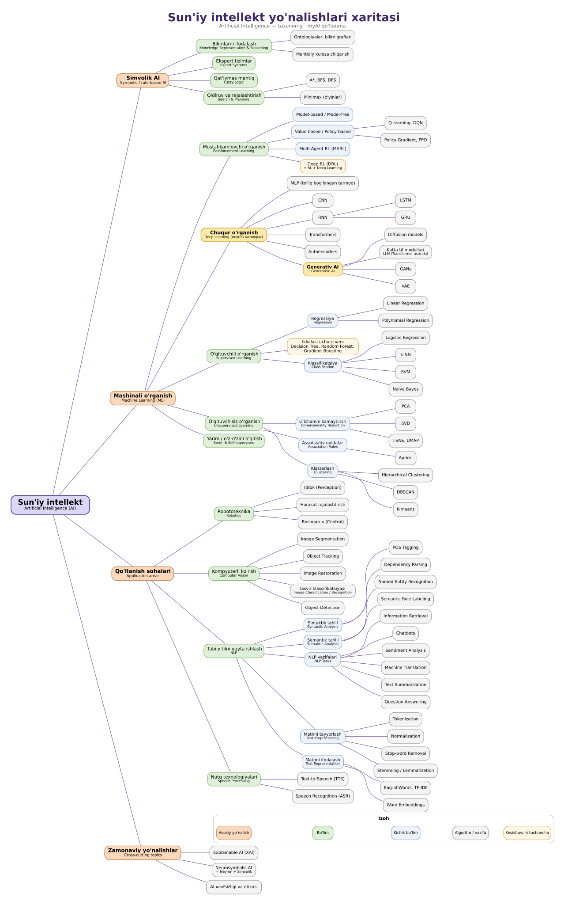

Kirish
================
**Sun'iy intellekt (AI)** - bu kompyuter tizimlarining odatda inson intellekti bilan bog‘liq bo‘lgan o‘rganish, fikrlash, muammolarni hal qilish, idrok etish va qaror qabul qilish kabi vazifalarni bajarish qobiliyati. Amaliy jihatdan AI – bu berilganlardan (data) foydalanib modellash, bashorat va qaror qilishni optimallashtirishdir.



```text
Artificial Intelligence
├── Symbolic (rule-based) AI
│   ├── Expert systems
│   ├── Fuzzy logic
│   └── Search and planning
├── Machine learning
│   ├── Supervised / unsupervised / reinforcement learning
│   └── Neural networks → Deep learning → Generative AI
└── Application areas
    ├── Computer vision
    ├── Natural language processing (and speech recognition)
    └── Robotics
```

- **Mashinali o‘rganish (*Machine learning*)** - Kompyuterlar ma’lumotlardan naqsh (pattern) va qonuniyatlarni o‘rganadi va shu asosida bashorat yoki qaror qabul qiladi.
  
- **Kompyuterli ko‘rish (*Computer vision*)** - Kompyuter tasvir yoki videodan obyektlarni ko‘rish va tanish qobiliyatiga ega bo‘ladi. Masalan: yuzni aniqlash, avtoulov raqamini o‘qish.

- **Qat'iymas mantiq (*Fuzzy logic*)** - Aniq “ha” yoki “yo‘q” qarorlardan tashqari, orasidagi qiymatlar (masalan, “biroz issiq”, “ko‘proq sovuq”) bilan ishlashga imkon beradi. Masalan: konditsioner avtomatik boshqaruvi.

- **Ekspert tizimlar (*Expert systems*)** - Ma’lum bir sohaga oid qoidalar va bilimlar bazasiga tayanib, mutaxassis kabi qaror chiqaradi. Masalan: tibbiy diagnostika dasturi.
  
- **Robototexnika (*Robotics*)** - AI yordamida robotlar harakatlanish, idrok qilish va muhit bilan o‘zaro ta’sir qilish imkoniyatiga ega bo‘ladi. Masalan: omborda buyurtmalarni yig‘uvchi robot.

- **Neyron tarmoqlar / Chuqur o‘rganish (*Neural networks/deep learning*)** - Inson miyasi ishlashiga o‘xshash model: ko‘p qatlamli tarmoqlar orqali murakkab naqshlarni o‘rganadi.

- **Tabiiy tilni qayta ishlash (*Natural language processing*)** - Kompyuterning inson tilini tushunishi, qayta ishlashi va yaratishi.

- **Generativ AI (*Generative AI*)** - Yangi kontent — matn, rasm, musiqa yoki video yaratadigan modellar.

---

**🧠 SUN'IY INTELLEKT / ARTIFICIAL INTELLIGENCE Roadmap**

Sun'iy intellekt sohasini o'rganish bo'yicha mukammal yo'l xaritasi.

---

**🟢 0. Asosiy tayyorgarlik**
*Dasturlash va matematik poydevor*
- **Dasturlash:** Python
- **Kutubxonalar:** NumPy, Pandas, Matplotlib
- **Matematika:**
    - Chiziqli algebra
    - Ehtimollik va statistika
    - Optimallashtirish asoslari
- **Ma'lumotlar bilan ishlash (Data Analysis)**

---

**🏛️ 1. Klassik AI / Symbolic AI**
*An'anaviy algoritmlar va mantiq*
- **Qidiruv algoritmlari:**
    - BFS (Breadth-First Search)
    - DFS (Depth-First Search)
    - A* (A-star)
    - Minimax algoritmi
- **Ekspert tizimlar**
- **Qoidalar asosida xulosa chiqarish**
- **Mantiqiy modellar**
- **Knowledge representation (Bilimlarni tasvirlash)**

---

**🤖 2. Machine Learning (Mashinali o'rganish)**
*Berilganlardan o'rganuvchi algoritmlar*

**Supervised Learning (Nazorat ostidagi o'rganish)**
- Regression & Classification
- k-NN (k-Nearest Neighbors)
- Decision Tree & Random Forest
- SVM (Support Vector Machines)
- Logistic Regression
- Gradient Boosting (XGBoost, LightGBM, CatBoost)

**Unsupervised Learning (Nazorat qilinmagan o'rganish)**
- **Clustering:** K-Means, DBSCAN, HDBSCAN, Hierarchical Clustering
- **Dimensionality Reduction:** PCA, t-SNE, UMAP
- **Anomaly Detection** (Anomaliyalarni aniqlash)

**Qo'shimcha tushunchalar**
- Semi-supervised & Self-supervised Learning
- **Feature Engineering** & Feature Selection
- **Model Evaluation (Baholash):**
    - Train/Test split, Cross-validation
    - Metrics: Accuracy, Precision, Recall, F1-score, ROC-AUC
    - Confusion Matrix
- **Overfitting / Underfitting** tushunchalari

---

**🕸️ 3. Deep Learning (Chuqur o'rganish)**
*Neyron tarmoqlari davri*
- **Neural Network asoslari:** Perceptron, Activation functions, Loss functions, Backpropagation, Gradient Descent
- **CNN (Convolutional Neural Networks):** Tasvirlarni klassifikatsiya qilish, obyektlarni aniqlash.
- **RNN / LSTM / GRU:** Ketma-ket ma'lumotlar va Time series (vaqtli qatorlar).
- **Transformer:** Attention mechanism, Encoder, Decoder, BERT, GPT, Vision Transformer.
- **Autoencoder:** Ma'lumotlarni siqish, shovqinni tozalash (Denoising).

---

**👁️ 4. Computer Vision (Kompyuter ko'rishi)**
- Image preprocessing (Tasvirlarga ishlov berish)
- **CNN Architectures:** LeNet, AlexNet, VGG, ResNet, EfficientNet
- **Object Detection:** R-CNN, Fast R-CNN, Faster R-CNN, YOLO, SSD
- **Segmentation:** U-Net, Mask R-CNN, DeepLab
- **Medical Imaging** (Tibbiy tasvirlar tahlili)

---

**💬 5. Natural Language Processing (NLP)**
*Tabiiy tilga ishlov berish*
- Text preprocessing & Tokenization
- **Modellar:** Bag of Words, TF-IDF, Word2Vec, FastText, BERT embeddings
- **Vazifalar:** Text classification, NER (Named Entity Recognition), Machine Translation, Text summarization
- **LLM (Large Language Models)** asoslari

---

**🎨 6. Generative AI**
*Yangi kontent yaratish*
- **LLM:** GPT, Claude, Gemini, Llama
- **Prompt Engineering**
- **RAG (Retrieval-Augmented Generation):** Embedding, Vector Database, Retrieval, Generation
- **Fine-tuning:** LoRA / QLoRA
- **Diffusion Models:** Image generation, Stable Diffusion
- **Multimodal AI:** Matn, tasvir, audio va video bilan birga ishlash.

---

**🎮 7. Reinforcement Learning**
*Rag'batlantirish orqali o'rgatish*
- Komponentlar: Agent, Environment, State, Action, Reward
- Policy & Value function
- Q-Learning & Deep Q-Network (DQN)
- Policy Gradient & Actor-Critic

---

**🚀 8. MLOps / AI Engineering**
*Modellarni amaliyotga joriy etish*
- Model deployment & API qilish (FastAPI / Django)
- **Docker** va konteynerizatsiya
- Model monitoring & Experiment tracking
- Data versioning (DVC)
- Cloud deployment (AWS, Google Cloud, Azure)

---

**⚖️ 9. AI Ethics and Safety**
*Etika va xavfsizlik*
- Bias (Yon bosish) va Fairness (Adolat)
- Explainability (Tushuntirib bera olish)
- Privacy (Maxfiylik) va Security (Xavfsizlik)
- Responsible AI & Legal issues (Huquqiy masalalar)

---
